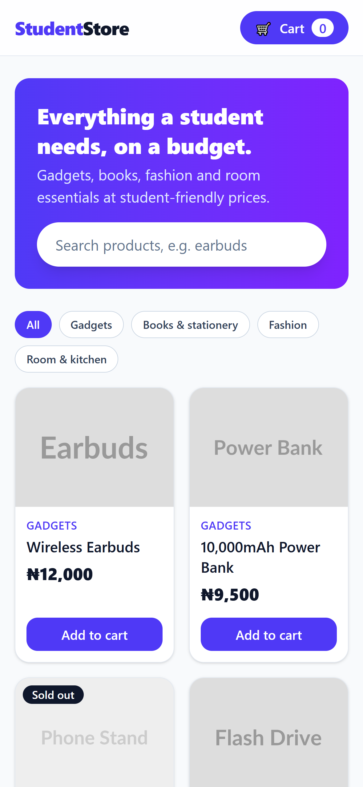
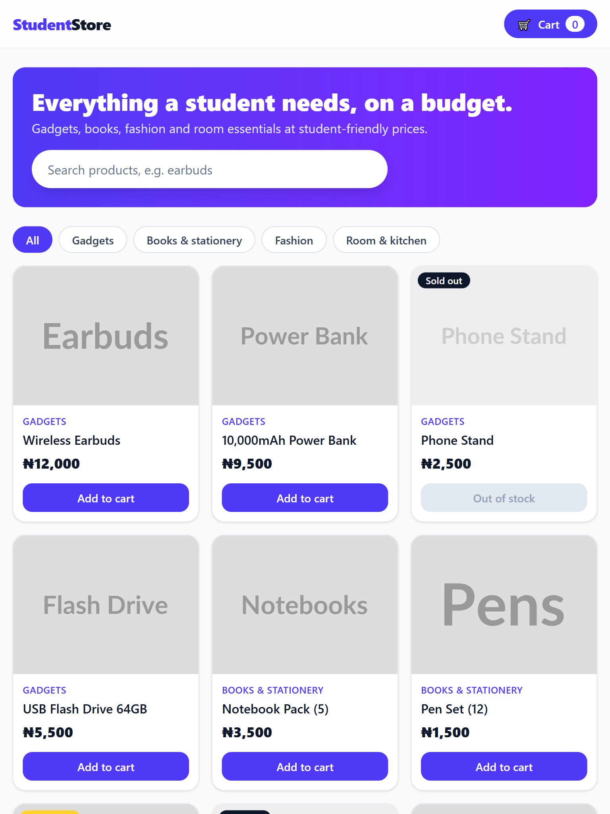
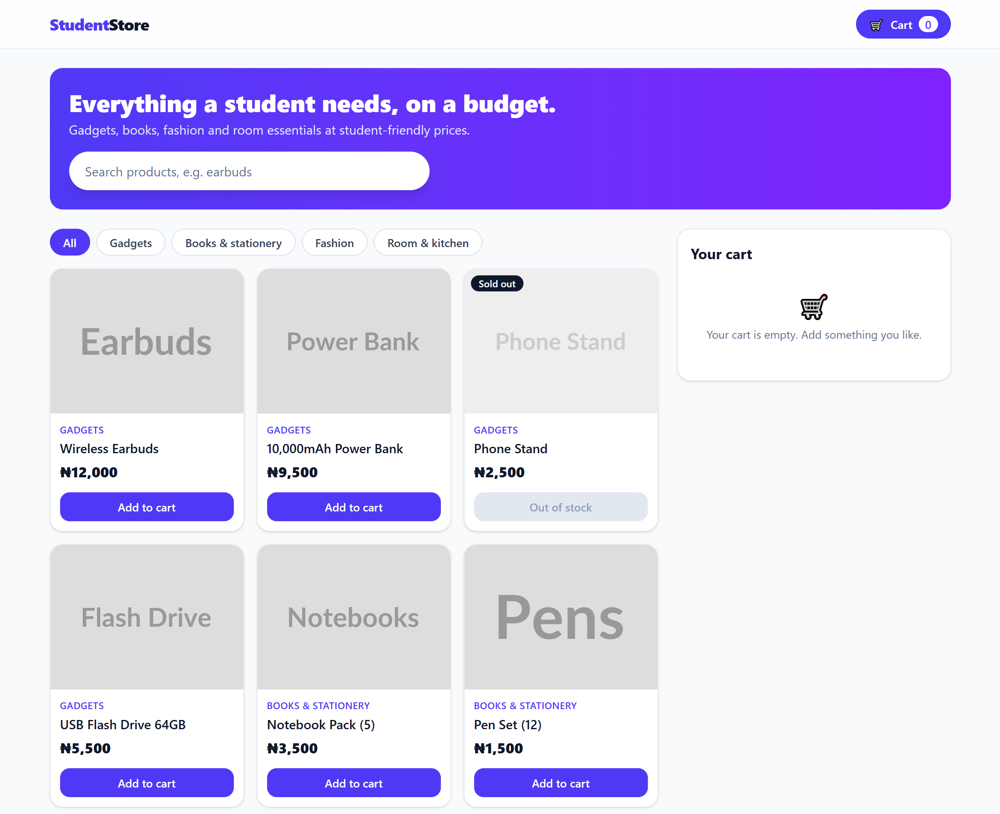

# Student Store

A responsive e-commerce storefront for students to browse and buy affordable products.
Built for the Arrowstack Frontend Development internship (Project 1).

## Target User

A student using a phone who wants to easily browse and buy affordable products.

## Features

- Responsive product grid (2, 3 or 4 columns by screen size)
- Category filters and search
- Cart with quantity controls, stock limits and total
- Checkout form with client-side validation
- Loading, empty, error and success states
- Keyboard navigation, skip link, labelled forms and ARIA messages

## Tech Stack

React, TypeScript, Vite, Tailwind CSS

## Run It

​```bash
npm install
npm run dev
​```
Open the link Vite prints. Add `?fail` to the URL to see the error state.

## Project Structure

- `src/types` : Product, Category and CartItem types
- `src/data` : mock products and fake API
- `src/components` : ProductCard, Cart, Checkout

## Testing and Validation

- Keyboard-only test: all items passed (see checklist)
- Lighthouse (mobile): Accessibility __/ Performance__ (report in `docs/`)
- Tested screen widths: phone, tablet, laptop
- Tested edge cases: empty cart, empty search, invalid form, stock limit, failed load

## Decisions

- Separate `Product` (shop data) from `CartItem` (shopper choice)
- Mock API behind one function, so a real API can replace it
- Typed `Category` to catch typos at compile time

## Limitations and Next Steps

- Uses mock data and a fake server, not a real API
- Cart is lost on refresh (next: save to localStorage)
- No real payment or user accounts
- Next: product detail page, sorting, real backend

## Screenshots





## Test Reports

- [Lighthouse mobile report](docs/lighthouse-mobile.html)
- [Lighthouse desktop report](docs/lighthouse-desktop.html)

- Lighthouse (production build, incognito):
- Mobile: Performance 97 / Accessibility 100 / Best Practices 100 / SEO 100
- Desktop: Performance 100 / Accessibility 100 / Best Practices 100 / SEO 100
- Reports in `docs/`
- An earlier dev-server run scored Performance 36 (extensions on, unminified code), so it was not a fair test.
- SEO was 92 until `public/robots.txt` was added.
- Known: about 35 KiB of unused JavaScript. Next: lazy-load the checkout form.
